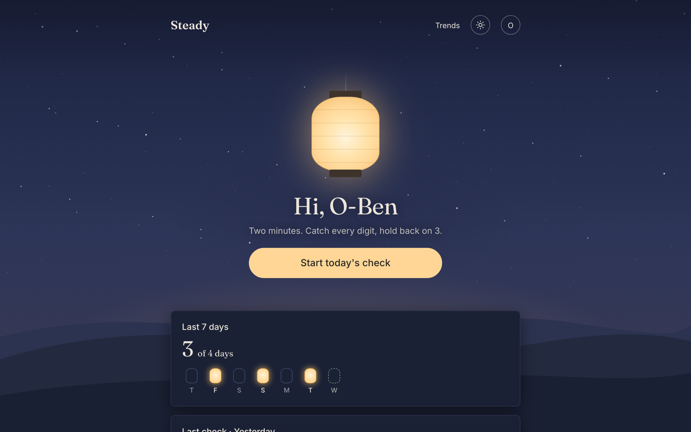
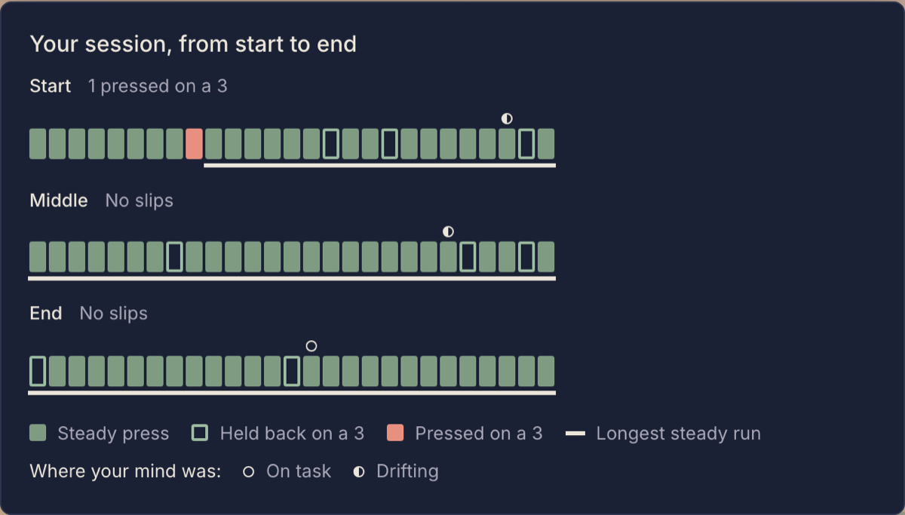
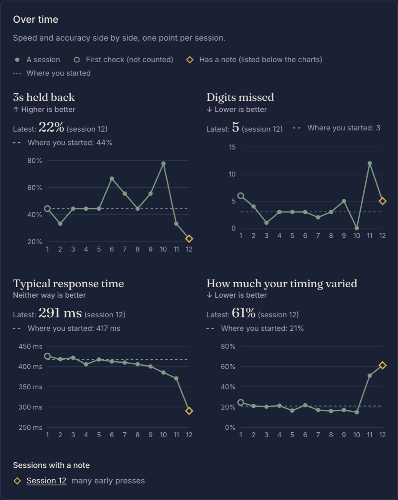
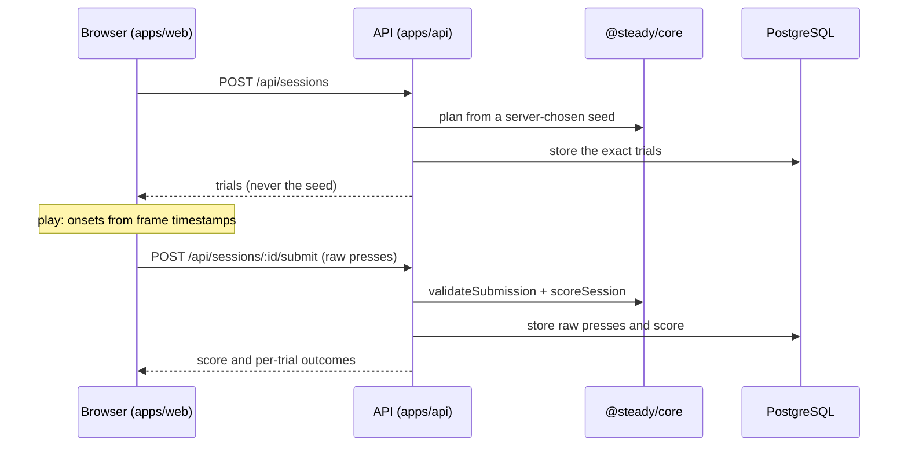

<div align="center">

# Steady

**A two-minute brain-training game for sustained attention, built on a well-studied research task.**

Press for every digit, hold back on 3. Steady measures how accurate, fast and even your attention was today, and compares it only with your own history.

[](https://github.com/ucfyao/steady/actions/workflows/ci.yml)


[](LICENSE)

[**Live demo**](https://steady-sand-ten.vercel.app) · [Design note](docs/design-note.md) · [Architecture](docs/architecture.md) · [Development log](docs/ai-log.md)



</div>

<details>
<summary><b>Contents</b></summary>

- [Overview](#overview)
- [Getting started](#getting-started)
- [Design](#design)
- [How it works](#how-it-works)
- [Key technical decisions](#key-technical-decisions)
- [Testing](#testing)
- [Assumptions, limitations and next steps](#assumptions-limitations-and-next-steps)
- [Time spent](#time-spent)
- [AI tools](#ai-tools)
- [Deployment](#deployment)
- [Documentation](#documentation)
- [Contributing](#contributing)

</details>

## Overview

Steady trains sustained attention with the **Sustained Attention to Response Task (SART)**, a standard research task for lapses of attention, and short **thought probes** that ask where your mind just was. Every session is saved and scored on the server, and progress is shown against the player's own starting point: honest about what improved, and never a promise of general brain gains or a rank against others.

### Features

- **Two minutes a day:** 81 trials and 3 probes at the standard SART timing, after a practice round that starts slow.
- **Four honest measures, no composite score:** 3s held back, digits missed, typical response time and how even the timing was, always side by side.
- **Progress in words:** "recent vs. where you started", with ordinary noise shown as "Similar", and charts per measure.
- **Several players, each seeing only their own data,** with no login required.
- **Three groups** (plain, calm lantern, game with points) to test whether the game layer changes what is measured.

<table>
  <tr>
    <td width="30%"></td>
    <td width="70%">
      
      <br><br>
      
    </td>
  </tr>
  <tr>
    <td align="center"><sub>Home on a phone (calm group)</sub></td>
    <td align="center"><sub>Results (each square is a digit) and Trends</sub></td>
  </tr>
</table>

### Built with

| Layer   | Technology                                                          |
| ------- | ------------------------------------------------------------------- |
| Web     | React 19, TypeScript, Vite 8, React Router, Recharts, CSS Modules   |
| API     | Node.js 26, TypeScript, NestJS 12, Drizzle ORM, Pino                |
| Core    | Framework-free TypeScript with Zod: session plan, scoring, progress |
| Data    | PostgreSQL 17 (Docker locally, Supabase in production)              |
| Tests   | Vitest, Testing Library, Testcontainers, Playwright                 |
| Hosting | Vercel (static web app, one serverless function), GitHub Actions CI |

## Getting started

Setup takes about five minutes, most of it the first download of dependencies and the Postgres image.

**Prerequisites:** Node.js 26 (`nvm use` reads `.nvmrc`), pnpm 10 (`corepack enable` installs the pinned version) and Docker running.

```bash
git clone https://github.com/ucfyao/steady.git
cd steady
pnpm install     # installs dependencies and builds @steady/core
pnpm bootstrap   # creates .env, starts Postgres 17 in Docker (port 5433), runs migrations, seeds demo players
pnpm dev         # web on http://localhost:5173, API on http://localhost:4000/api
```

Open http://localhost:5173. A first visit starts with how-to-play steps and a short practice round; a full session takes about two minutes.

| Command          | What it does                                                                       |
| ---------------- | ---------------------------------------------------------------------------------- |
| `pnpm dev`       | Web, API and core in watch mode                                                    |
| `pnpm check`     | Core build, lint, format check, typecheck and all tests (CI runs the same command) |
| `pnpm e2e`       | Playwright end-to-end tests against the real stack (about 4 minutes)               |
| `pnpm seed:demo` | Rebuilds the six demo players                                                      |

Before the first `pnpm e2e`, install the browser once: `pnpm --filter @steady/web exec playwright install chromium`.

### Demo players

`pnpm bootstrap` (and `pnpm seed:demo` at any time) creates six players, a returning and a new one in each group, so every state can be shown without playing ten sessions. Switch between them in the avatar menu (top right). The same six are on the [live demo](https://steady-sand-ten.vercel.app), where visitors may have added sessions.

| Group                                                                     | Returning player | New player |
| ------------------------------------------------------------------------- | ---------------- | ---------- |
| **Plain:** the original SART screen, a bare digit and the `⊗` mask        | O-Ava            | N-Amy      |
| **Calm:** the lantern scene and its glow, no points                       | O-Ben            | N-Bella    |
| **Game:** the lantern with points, a multiplier, fireflies and a dawn sky | O-Cleo           | N-Cora     |

`O-` is a returning (old) player and `N-` a new one; the first name's initial gives the group (**A** plain, **B** calm, **C** game). Why there are three groups, and what is the same in all of them: [design note, Three groups](docs/design-note.md#three-groups-testing-that-fun-does-not-change-the-measure).

- **Returning players** have 10 scored sessions over two weeks, 7 with a sleep or stress check-in: session 1 is not counted, sessions 2–6 set the starting point, and 3 of the last 7 days are played, one short of the weekly target. Use them for Home with history, Results compared with the starting point, and Trends; O-Cleo also has a personal best and a gallery of skies.
- **New players** have no sessions. Use them for a first visit: how-to-play, practice and the first Results.

The tokens are fixed, so rerunning the seed rebuilds the same six players (history relative to today) instead of adding copies.

### Use Supabase instead of Docker

Steady uses Supabase only as PostgreSQL, so switching is a matter of `DATABASE_URL`: copy the project's **session pooler** URL (under **Connect**), set it in `.env` in place of the Docker one (the commented example shows the shape, with `?sslmode=no-verify`), and run `pnpm bootstrap` again. Migrations and demo players always go to whichever database `DATABASE_URL` names. Hosting on Vercel: [docs/deployment.md](docs/deployment.md).

## Design

The full reasoning, options and sources are in the **[design note](docs/design-note.md)**. In short, three rules decide every choice: measure one thing well and claim only what it supports; compare a player only with themselves; make coming back worthwhile without changing what is measured.

| Question                 | Choice                                                                                                                                                                                                    |
| ------------------------ | --------------------------------------------------------------------------------------------------------------------------------------------------------------------------------------------------------- |
| Which game?              | SART with thought probes, chosen over Stroop, N-back, task switching, PVT and breath counting                                                                                                             |
| How does it play?        | The digit on a lantern's glass in a night scene, after the lantern-riddle game: the theme sits around the digit, never in it                                                                              |
| How is it scored fairly? | Four measures computed on the server from raw presses; no pass mark, only your own history; odd behaviour flagged, not rejected                                                                           |
| What brings people back? | A loop at three time scales: instant feedback from the lantern, a result and comparison after each session, a weekly target of 4 of 7 days instead of a streak; a team rewards economy designed for later |
| How is progress shown?   | "Recent vs. where you started", in words, with a noise band, then charts with speed and accuracy side by side                                                                                             |

## How it works



```
apps/
  api/        NestJS 12 + Drizzle + PostgreSQL 17: players, sessions, progress, health
  web/        React 19 + Vite 8: Home, the check, Results, Trends, Manage players
packages/
  core/       Pure TypeScript: session plan, validation, scoring, progress, Zod contracts
specs/        One folder per feature: spec.md, plan.md, tasks.md (index in specs/README.md)
docs/         Design note, architecture, deployment, operator view, development log
```

**Data model:** two tables. `players` holds a token hash, a name and the player's group. `sessions` holds one row per session: the server's seed, the exact trials, the check-in, the input device, the raw presses and the score as JSONB, with the scoring version so history can be re-scored. **API:** create and list players; start, submit and list sessions; progress; health. Every route except creating and listing players and health needs `Authorization: Bearer <token>`. Full tables and status codes: [docs/architecture.md](docs/architecture.md).

## Key technical decisions

The most important ones, each with its trade-off. All of them, with the reasoning: [docs/architecture.md](docs/architecture.md#technical-decisions).

| Decision                                                                                                | Why                                                                                        | Trade-off                                                                                    |
| ------------------------------------------------------------------------------------------------------- | ------------------------------------------------------------------------------------------ | -------------------------------------------------------------------------------------------- |
| **Scoring in a framework-free package** (`@steady/core`), called only by the API                        | One place for every rule, tested in isolation; the client can never compute a score        | A build step for core, run automatically on install, dev and check                           |
| **The server owns the seed, the clock and the score**                                                   | A browser cannot choose its sequence or its result; raw presses are kept for re-scoring    | Browser input still cannot be fully trusted, so odd timing is flagged, never called cheating |
| **One session, one row**, trials and presses as JSONB                                                   | Atomic writes; every result can be recomputed from what was stored                         | No trial-level SQL queries, which nothing needs yet                                          |
| **Identity by token, not login;** every query scoped to the token's player                              | Meets "each player sees only their own data" without accounts                              | No recovery; for the demo the player list is public (one route to close)                     |
| **The trial clock is plain TypeScript on frame timestamps;** the digit is written straight into the DOM | Timing is unit-tested with synthetic times; scripted 400 ms presses recorded at 400–405 ms | Display can still lag by up to one frame (about 17 ms at 60 Hz)                              |
| **Every tunable rule in one file** (`packages/core/src/config.ts`), marked research or product decision | Thresholds are reviewable in one place and never hard-coded elsewhere                      | Changing a scoring rule means bumping the scoring version                                    |
| **Tests on a real PostgreSQL** (Testcontainers), not mocks                                              | A missing `player_id` filter would pass against a mock                                     | API tests need Docker                                                                        |
| **ESM everywhere, Vitest everywhere,** the API built with plain `tsc`                                   | One module system and one test runner across the monorepo                                  | Nest needs SWC for tests and explicit `@Inject()`, because esbuild drops decorator metadata  |
| **Two Vercel projects** (static web, one serverless API) and Supabase used only as PostgreSQL           | One origin for the browser; local and production differ only in `DATABASE_URL`             | The web project names the API's domain; web previews call the production API                 |

## Testing

Tests concentrate where a bug would give a player a wrong result or another player's data:

| What                             | How                                                                                                                                     |
| -------------------------------- | --------------------------------------------------------------------------------------------------------------------------------------- |
| **Scoring and progress** (core)  | Vitest; expected values come from the spec or an independent calculation (Python `statistics`), never from the code under test          |
| **Player isolation and the API** | The real Nest app on PostgreSQL 17 (Testcontainers) with a fake clock: another player's session is a `404`, retries, races, rate limits |
| **Timing** (web)                 | The trial runner with synthetic frame and press times: windows, anticipations, probes                                                   |
| **Whole sessions** (end to end)  | Playwright plays full sessions with real key presses in real time: results, progress, a second player seeing none of it, voiding        |

Each new rule is also broken on purpose to confirm a test fails; more than 100 such mutation checks have been run, and the gaps they found are in the [development log](docs/ai-log.md). CI runs `pnpm check`, `pnpm build` and the end-to-end tests on every pull request.

## Assumptions, limitations and next steps

**Assumptions**

- Attention training is most useful as a private daily habit, compared with yourself; nobody needs to see a rank.
- A login is not required (per the brief), so a random token stands in for an account.
- Players use a keyboard or a touch screen, and keep the page open for two minutes.

**Limitations**

- **Not a clinical tool.** The 81-trial session is shorter than the standard 225 and not validated; all comparisons are within one player and exploratory.
- **Browser timing** can lag by up to a frame, and keyboard and touch latency differ, so each session records its device.
- **No accounts or recovery.** For the demo every player is listed for everyone; a lost token means lost history.
- **The group comparison has no screen yet:** with a handful of players it would mean nothing.
- **Leaving the page voids a session,** because the timing would be broken.

**With more time**

- Real accounts (or employer SSO) and a private player list.
- The [operator view](docs/operator-view.md) for teams: aggregates only, at least 10 players per group.
- A rewards economy for teams: points for showing up, a store of employer-funded prizes, later a digital token; rewards follow participation, never scores ([design note §8](docs/design-note.md#8-beyond-the-demo-a-rewards-economy-for-teams)).
- An n-of-1 experiment (a minute of mindful breathing first, on random days), an error score corrected for speed, and a task-switching mode.

## Time spent

About three and a half days in total:

| When              | Time        | What                                                                                                                                                                |
| ----------------- | ----------- | ------------------------------------------------------------------------------------------------------------------------------------------------------------------- |
| Sunday evening    | One evening | Research and the design note, then a plan split into specs; several AI agents built the first version in parallel, each in its own worktree                         |
| The next two days | Two days    | Two new versions from play-testing: the **calm** lantern scene, and the **game** with points and a dawn sky, with the original screen kept as the **plain** control |
| Then              | Half a day  | Deployment to Vercel and Supabase, and the documentation                                                                                                            |

Most of the time went into the two days of iteration: play-testing, the three groups, and checking every change in a real browser, at phone and desktop width, light and dark. The first version, with its scoring core, API and tests, was the fastest part, because the specs were written and reviewed before the agents started.

## AI tools

Yes, throughout, as I would on the job. AI wrote much of the code; I set the workflow, reviewed every spec before code was written, and reviewed and merged every pull request myself.

| Tool                                                             | What it was used for                                                                                                                                                 |
| ---------------------------------------------------------------- | -------------------------------------------------------------------------------------------------------------------------------------------------------------------- |
| **Claude Code**                                                  | Pair programmer: specs, implementation, tests, docs, under the rules in [CLAUDE.md](CLAUDE.md); several agents in parallel, one worktree each, for the first version |
| **OpenAI Codex**                                                 | A second model as an independent reviewer of pull requests, so one model's blind spots are not also the reviewer's                                                   |
| **[GitHub Spec Kit](https://github.com/github/spec-kit) layout** | One spec, plan and task list per feature in [`specs/`](specs/README.md), reviewed before any code                                                                    |
| **[gstack](https://github.com/garrytan/gstack) skills**          | `browse`: a headless browser for real-stack checks, screenshots and layout measurements; `design-shotgun`: design variants to compare before building                |
| **UI/UX skills**                                                 | `ui-ux-pro-max` for UI/UX reviews (keyboard paths, contrast in light and dark, layouts from 375 px to 2000 px); `dataviz` for the Trends charts                      |
| **Process skills**                                               | `superpowers:brainstorming` before new features, `systematic-debugging` for root causes, and my own `worktree-workflow` for branches and pull requests               |

**How the work was kept honest**

- **Spec first, tests first:** each rule is in a spec before it is in code, and tests take their expected values from the spec or an independent calculation, so a wrong rule cannot also produce its own expected value.
- **Deliberate breakage:** after each change, every new rule is broken on purpose to confirm a test fails.
- **Real use:** headless-browser runs against the real stack and my own play-tests, which found, for example, that the first game was too fast to learn.

**Learning from mistakes.** Every time the AI's output was wrong or weak, it is recorded in the **[development log](docs/ai-log.md)** with how it was caught and the fix: 70 entries, grouped by kind, from tests that could not fail to layout faults only a browser shows. The log is not only a record: recurring lessons are turned into standing instructions so they do not happen again, as rules in [CLAUDE.md](CLAUDE.md) (for example "run `pnpm install` first in every new worktree" and "screens are remounted per player"), as the agent's persistent memory (check which dev servers are running before an end-to-end run, so tests never reach the production database), and as reusable skills, such as `worktree-workflow` for branches, worktrees and pull requests.

## Deployment

Production runs as two Vercel projects with Supabase as the database; every push to `main` deploys, and pull requests get previews.

| Service | URL                                                                           |
| ------- | ----------------------------------------------------------------------------- |
| Web     | [steady-sand-ten.vercel.app](https://steady-sand-ten.vercel.app)              |
| API     | [steady-api-bay.vercel.app/api](https://steady-api-bay.vercel.app/api/health) |

Setup, migrations and troubleshooting: [docs/deployment.md](docs/deployment.md).

## Documentation

| Document                               | Contents                                                                      |
| -------------------------------------- | ----------------------------------------------------------------------------- |
| [Design note](docs/design-note.md)     | Research, options and choices: which game, scoring, coming back, progress     |
| [Architecture](docs/architecture.md)   | Data model, API reference, every technical decision and its cost, testing     |
| [Deployment](docs/deployment.md)       | Vercel and Supabase setup, releasing, migrations, troubleshooting             |
| [Operator view](docs/operator-view.md) | An aggregate view for teams: designed, not built                              |
| [Specs](specs/README.md)               | Every feature's spec, with its status                                         |
| [Development log](docs/ai-log.md)      | Mistakes made while building with an AI pair programmer, and what caught them |
| [CLAUDE.md](CLAUDE.md)                 | Rules for AI coding agents working in this repository                         |

## Contributing

Every change follows the same path:

1. **A spec** in `specs/NNN-name/` (see [specs/README.md](specs/README.md)), reviewed before code.
2. **A feature branch** (`feature/…` or `fix/…`) and failing tests first.
3. **`pnpm check`** passes locally; CI runs it again with the build and the end-to-end tests.
4. **A pull request**, squash-merged into the protected `main`, with conventional commit titles (`feat:`, `fix:`, `docs:`…).

AI coding agents follow the same rules, written down in [CLAUDE.md](CLAUDE.md).

## License

[MIT](LICENSE)
